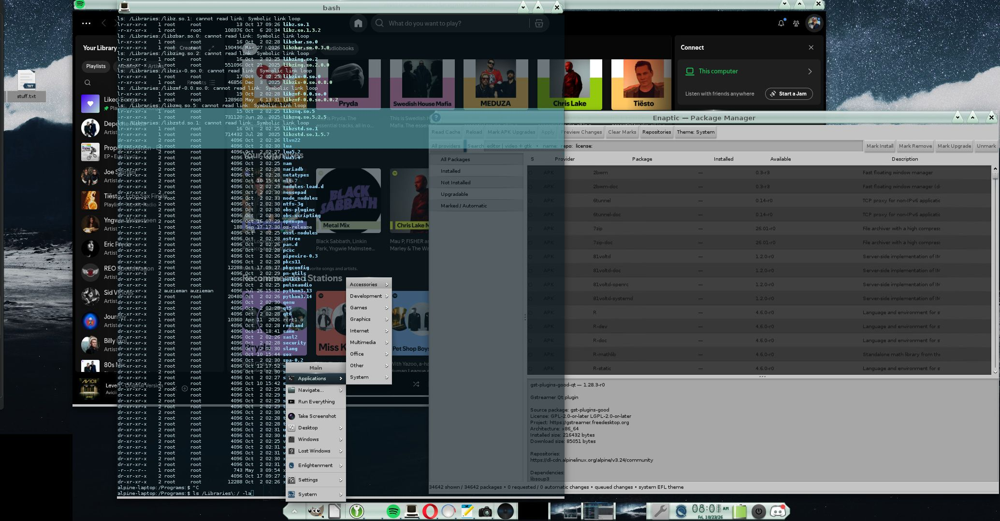

# Minty for Enlightenment

Minty is an early Enlightenment desktop theme with soft mint-green frosted glass,
small truncated-triangle controls and matching window and shelf edges. It is
built on the Ice theme and shares its first-pass implementation with
[Frosty and Minty](https://github.com/auzieman/BlackKnight-E-Theme).

## Status

A first desktop candidate has been built and tried on the author's desktop.
The window and shelf materials are original; most widgets and additional border
styles are inherited from Ice. Full desktop behavior and contrast across all
widgets still need testing. The screenshot includes an older Auzix Assigns
session before its library-link correction.

## Build

See [desktop build and provenance notes](theme/desktop/README.md). The generator
produces both Frosty and Minty from an extracted installed Ice theme and the
original components in `theme/assets`. The build does not apply the theme.

## Licensing and downloads

Original project code is GPLv3 and original artwork is CC BY-SA 4.0. Ice and
its embedded assets retain upstream terms; supplied upstream notices are in
[theme/upstream-notices](theme/upstream-notices). The upstream image notice needs
further clarification before we distribute complete theme binaries, so this
repository currently provides source adaptations and build instructions only.

The related experimental [Auzix Assigns](https://github.com/auzieman/auzix-assigns)
project provides Amiga-inspired named views of existing directories.
